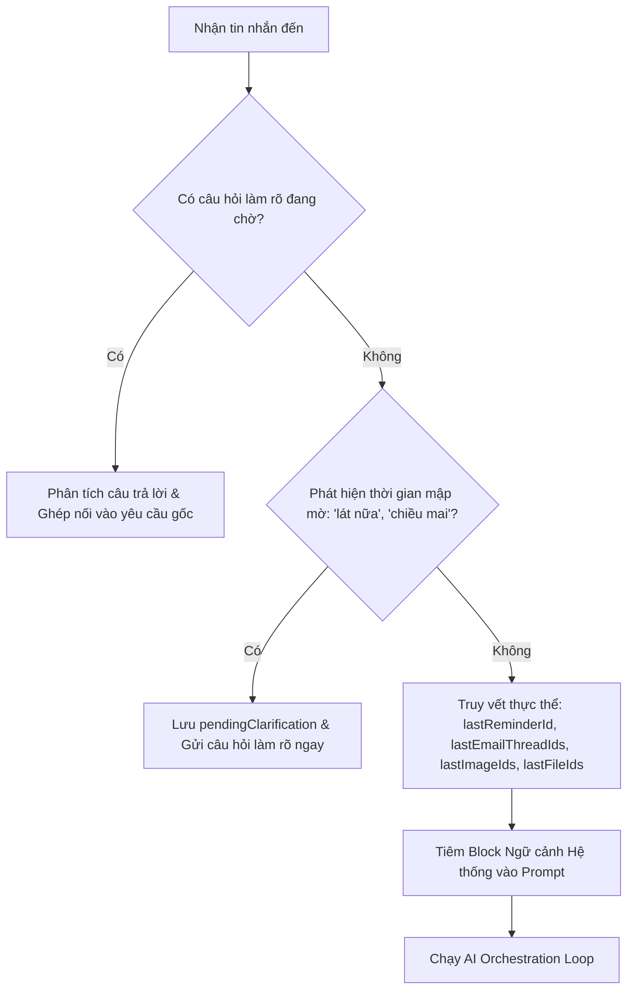

# Trí tuệ Hội thoại Đa lượt & Quản lý Ngữ cảnh (Conversation Intelligence)

Tài liệu này mô tả chi tiết kiến trúc giải quyết ngữ cảnh đa lượt (multi-turn context resolution), quản lý trạng thái cuộc trò chuyện và xử lý câu hỏi làm rõ (clarification prompt) trong Zalo AI Agent.

---

## 1. Mục tiêu & Vấn đề Cần Giải Quyết

Khi người dùng trò chuyện qua Zalo:
- **Tham chiếu đại từ & sự kiện trước đó:**
  - *"dời thêm 15 phút nữa"* -> Cần biết chính xác lời nhắc nào vừa được tạo để cập nhật.
  - *"hủy nhắc việc vừa rồi"* -> Cần lấy `lastReminderId` để hủy.
  - *"soạn thư trả lời cái thứ 2"* -> Cần lấy chính xác email thread ID thứ 2 từ danh sách email vừa đọc.
  - *"chibi hóa ảnh này"* hoặc *"ảnh vừa tạo"* -> Cần lấy chính xác File ID ảnh người dùng vừa gửi hoặc ảnh bot vừa sinh.
- **Thời gian mập mờ (Ambiguous Time Clarification):**
  - Người dùng nhắn: *"lát nữa nhắc anh...", "tí nữa nhắc anh...", "chiều mai nhắc anh..."* mà không nói rõ giờ.
  - Bot phải lịch sự hỏi lại để làm rõ mốc thời gian cụ thể trước khi thực thi.

---

## 2. Mô hình Dữ liệu Trạng thái Hội thoại (`ConversationState`)

Được lưu trữ bền vững trong PostgreSQL với bảng `ConversationState`:

```prisma
model ConversationState {
  id                   String   @id @default(uuid())
  conversationId       String   @unique
  userId               String
  chatId               String
  chatType             String   @default("PRIVATE")
  currentTopic         String?
  activeTaskId         String?
  lastReminderId       String?
  lastEmailThreadIds   Json?    // Array of string IDs
  lastFileIds          Json?    // Array of recent File IDs
  lastImageIds         Json?    // Array of recent Image File IDs
  pendingClarification Json?    // { intent, prompt, originalText, missingSlots }
  createdAt            Date     @default(now())
  updatedAt            Date     @updatedAt
}
```

---

## 3. Quy trình Giải quyết Ngữ cảnh (`ContextResolverService`)

Trước khi yêu cầu được chuyển tới mô hình AI, `ContextResolverService` tự động thực hiện:



### Các quy tắc giải mã (Resolution Rules):
1. **Lời nhắc:**
   Khi tin nhắn chứa các từ: *"lời nhắc", "nhắc việc", "dời thêm", "hoãn thêm", "hủy nó", "hủy đi"* và trong trạng thái có `lastReminderId`, bot sẽ tiêm chỉ dẫn vào prompt:
   > *Lời nhắc đang được người dùng tham chiếu gần nhất có mã ID: "<id>". Hãy sử dụng ID này khi gọi `reschedule_reminder` hoặc `cancel_reminder`.*
2. **Thứ tự Email (Ordinals):**
   Khi người dùng nói *"cái thứ nhất/1", "cái thứ 2/hai", "cái thứ 3/ba"*, hệ thống tự động ánh xạ thành chỉ mục mảng `lastEmailThreadIds[index]`.
3. **Ảnh & File:**
   Tự động gán File ID của ảnh/file vừa sinh hoặc vừa nhận vào tham số của `edit_image` nếu người dùng không cung cấp ID rõ ràng.

---

## 4. Định vị Thời gian Chuẩn xác (Time Anchor)

Mọi tính toán thời gian tương đối như:
- *"10 phút nữa"*
- *"nửa tiếng nữa"*
- *"2 tiếng nữa"*
- *"lúc 15h"*
- *"mai 8h"*

Đều được neo vào mốc thời gian thực của máy chủ theo múi giờ **`Asia/Ho_Chi_Minh`** (`receivedAt`).
Đồng thời, thời gian hiện tại của hệ thống được tiêm trực tiếp vào đầu System Prompt của LLM ở mỗi lượt gọi để đảm bảo AI tính toán chính xác 100% thời gian ISO 8601 UTC.
