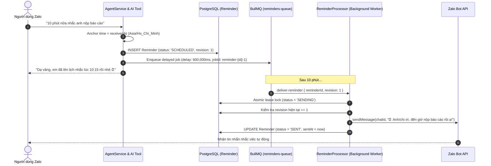

# Hướng dẫn Khắc phục & Vận hành Hệ thống Nhắc nhở Tự động (Reliable Reminders)

Tài liệu này cung cấp chi tiết kỹ thuật về kiến trúc, nguyên nhân gốc rễ và quy trình vận hành hệ thống nhắc việc tự động (proactive reminders) trên Zalo Bot.

---

## 1. Nguyên nhân Gốc rễ của lỗi "Im lặng không nhắc" (Root Cause Analysis)

Trước đây, khi người dùng yêu cầu: *"10 phút nữa nhắc anh làm việc nhé"*, bot trả lời *"Dạ vâng, em sẽ nhắc anh"*, nhưng 10 phút sau bot hoàn toàn im lặng.

### Các nguyên nhân kỹ thuật đã được phân tích và xử lý triệt để:
1. **Thiếu liên kết BullMQ:** Trước đây tool `CreateReminderTool` chỉ insert bản ghi thô vào bảng `ScheduledTask` mà **hoàn toàn không gọi `SchedulerService` hay đẩy delayed job vào BullMQ**.
2. **Không có công cụ hủy / dời lịch:** Hệ thống không có tool `reschedule_reminder`, `cancel_reminder`, `list_reminders` để LLM xử lý các lượt hội thoại tiếp theo.
3. **Phụ thuộc tin nhắn kích hoạt (No Inbound Trigger Needed):** Lời nhắc hẹn giờ phải được kích hoạt **chủ động (proactive)** từ Background Worker mà không phụ thuộc vào việc người dùng có nhắn tin thêm hay không.
4. **Mất job khi khởi động lại server hoặc Redis:** Nếu Redis bị restart hoặc Server tắt trong lúc tới giờ hẹn, lời nhắc bị rơi vào trạng thái treo (stale).

---

## 2. Kiến trúc Giải pháp Bền vững



---

## 3. Quản lý Vòng đời & Trạng thái Lời nhắc (State Machine)

| Trạng thái | Ý nghĩa | Hành động tiếp theo |
| :--- | :--- | :--- |
| `SCHEDULED` | Đã lưu DB và đã nạp delayed job vào BullMQ | Chờ đến giờ BullMQ kích hoạt |
| `SENDING` | Worker đã nhận job và giữ khóa lease | Gửi tin qua Zalo API |
| `SENT` | Đã gửi thành công tới Zalo chat | Hoàn tất |
| `CANCELLED` | Đã hủy bởi người dùng qua lệnh hoặc chat | Không gửi, xóa job khỏi Redis |
| `FAILED` | Gửi lỗi quá số lần retry (tối đa 3 lần) | Chờ can thiệp quản trị |

---

## 4. Cơ chế Tự phục hồi (Self-Healing Reconciliation)

Hệ thống chạy quy trình kiểm tra và tự phục hồi tự động tại 2 thời điểm:
1. **Khi hệ thống khởi động (`onModuleInit`):**
2. **Định kỳ mỗi 3 phút:**

### Các tình huống tự phục hồi:
1. **Server bị tắt đúng vào lúc đến giờ hẹn:**
   - Hệ thống phát hiện các Reminder có `status: 'SCHEDULED'` mà thời gian `dueAt` đã qua hơn 1 phút và chưa gửi tin bù.
   - Hệ thống lập tức gửi ngay tin nhắn Zalo kèm lời xin lỗi lịch thiệp:
     > *"⏰ LỜI NHẮC (Gửi bù): Anh/chị ơi, đến giờ ... rồi ạ! (Dạ em xin lỗi vì thông báo bị trễ lúc HH:mm do hệ thống máy chủ vừa khởi động lại ạ)."*
2. **Redis bị mất job (Flush/Restart):**
   - Tự động nạp lại (re-enqueue) các job delayed tương ứng vào BullMQ với độ trễ chính xác còn lại.
3. **Mở khóa lease bị treo (`SENDING` > 5 phút):**
   - Đưa trạng thái về `SCHEDULED` để tái xử lý.

---

## 5. Các Lệnh Quản trị & Chẩn đoán Nhanh

Trong chat Zalo với bot, bạn có thể gửi trực tiếp các lệnh sau:

- `/reminder-health` : Kiểm tra sức khỏe kết nối Redis, BullMQ và số lượng job delayed, số reminder đang chờ trong DB.
- `/reminder-test` : Tạo ngay một lời nhắc thử nghiệm hẹn sau **60 giây**. Đợi 1 phút, bot sẽ chủ động nhắn tin thông báo.
- `/reminders` : Xem danh sách tất cả các lời nhắc đang lên lịch kèm mã ID.
- `/reminder-cancel <id>` : Hủy lời nhắc theo mã ID cụ thể.

---

## 6. Xử lý sự cố thường gặp (Troubleshooting Steps)

1. **Kiểm tra Redis:**
   ```bash
   docker ps | grep redis
   # Đảm bảo Redis container chạy trên cổng 6380 (hoặc cổng trong .env)
   ```

2. **Kiểm tra Background Worker:**
   ```bash
   # Worker phải chạy để tiêu thụ hàng đợi BullMQ:
   npm run start:worker
   ```

3. **Kiểm tra Log:**
   Tìm log `[REMINDER_WORKER]` hoặc `[SCHEDULER]`:
   ```bash
   tail -f logs/app.log | grep REMINDER
   ```
